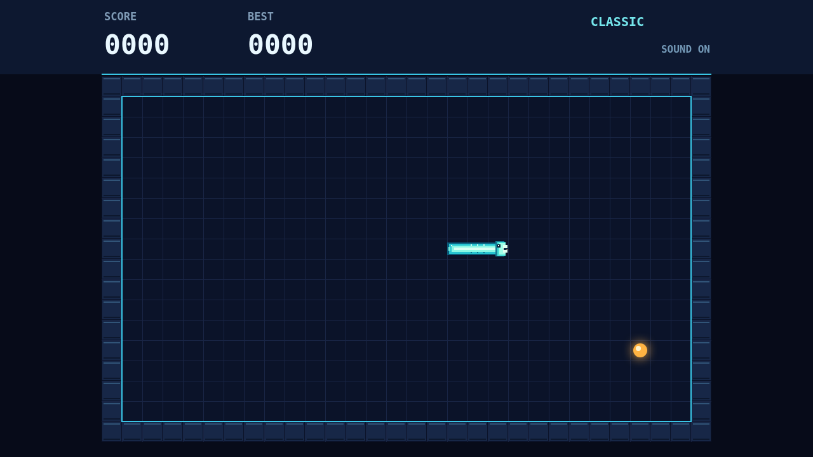

# Coil

A bright serpent cuts across a midnight grid. Guide its head between the solid border and the trail it leaves behind, collecting sparks one cell at a time.

Every spark lengthens the coil. It never stops moving, so plan the next turn before the path closes around you. Arrow keys or WASD steer; Enter starts a round, P pauses, and M toggles sound.

Catch another spark before the combo bar empties to raise your multiplier. A clean route keeps the glow alive and turns a small score into a fast climb.

